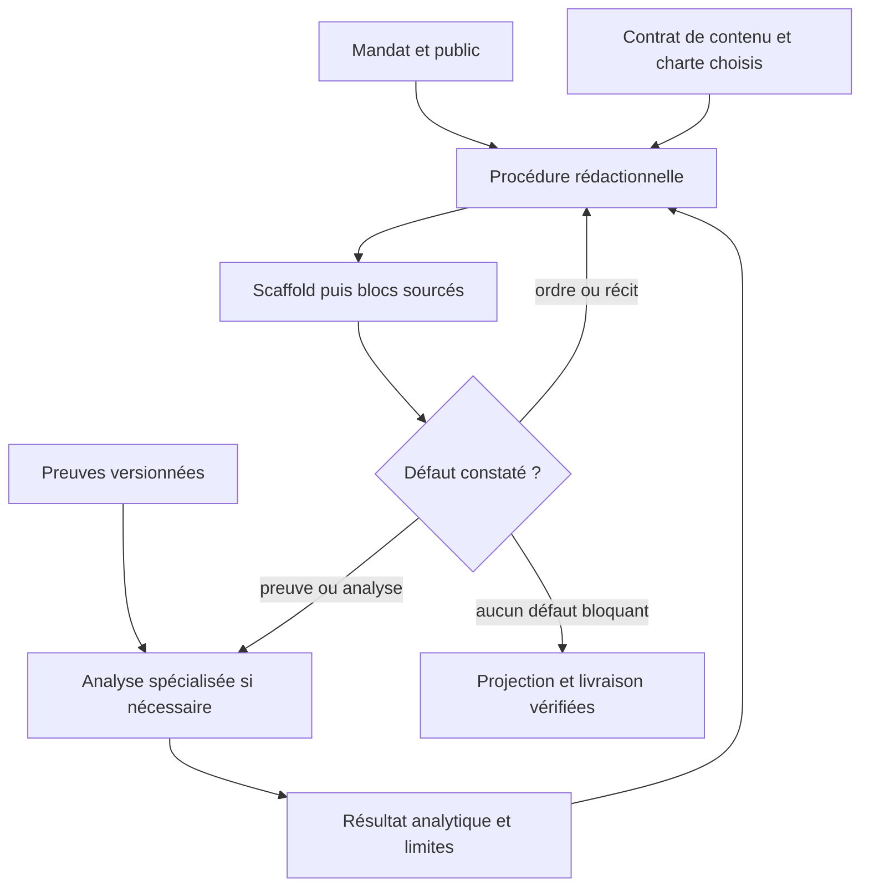

# Factoriser la procédure, préserver les contrats de raisonnement
Statut : proposition candidate sur branche ; aucune migration du canon.

## Ce qui converge
Une procédure reçoit mandat, preuves et analyses ; elle choisit les obligations de format, dirige un scaffold, rédige des blocs, examine le récit et projette le contenu vers le support. Les rôles directeur, scribe, relecteur et livraison décrivent des responsabilités ; ils ne nécessitent pas quatre agents.

Source Mermaid portable, sémantique relue ; parseur et rendu du diagramme non exécutés.

## Limites de l’analogie CSS
Une charte visuelle décrit présentation et support. Un scaffold de contenu porte aussi ordre logique, preuves obligatoires et promesse au lecteur. Le changer peut invalider l’analyse ou la narration. Les traiter tous comme du CSS ferait disparaître cette différence.

## Classes de ressources
- Mandat et route principale : pédagogie, business, produit ou technique ; angles secondaires explicites.
- Contrat de contenu : finalité, questions, champs obligatoires et limites. Conserver les contrats canoniques existants.
- Profil de longueur/rendu : densité, pages, cartes, diagrammes, styles ; pas d’ajout de preuve.
- Capacité d’analyse : tâche autonome avec entrées/sorties et exigence de preuve. Référence interne avant de justifier une nouvelle skill.
- AnalysisResult : résultat versionné, input_claim_refs, contre-preuves, inconnues, affects_blocks. Le validateur contrôle structure/références, pas vérité ou rigueur du raisonnement.
- RUN : données et checkpoints privés ; BUILD : méthode, schémas, fixtures synthétiques.

## Ce qu’un premier test ne généralise pas
Le cas couvre produit avec angle business. Il ne prouve pas le transfert pédagogique ou technique, ni l’exécution de PESTEL/VRIO/TOWS par des skills spécialisées. La fiche pédagogique dispose déjà d’un parcours procédural et de contrats propres ; sa migration doit préserver les acquis, exercices et vérifications. Un one-pager exécutif ne devient pas automatiquement une fiche d’apprentissage.

## Enchaîner des analyses avec retenue
Partir d’une question qui modifie le verdict, sélectionner une méthode, publier son résultat avec les claims mobilisés, rouvrir les blocs dépendants, puis arrêter si l’inconnue exige une observation terrain. Les facteurs SWOT peuvent alimenter des options TOWS, mais une combinaison ne démontre pas son résultat. Déclarer les dépendances, les budgets et les conditions de sortie avant une longue chaîne. Aucun scheduler ou bus nouveau n’est nécessaire pour ce premier candidat.

## Migration proposée
Conserver dev comme intégration. Introduire un seul parcours rédactionnel optionnel, garder les templates canoniques comme contrats, puis extraire leurs redondances sans en retirer les invariants. Conserver les huit skills d’analyse du prototype comme spécialisations candidates ; factoriser seulement leurs règles répétées de style et de restitution. Tester ensuite une note technique et une fiche pédagogique, puis une reprise itérative avec source contradictoire. Promouvoir une capacité à la fois.

