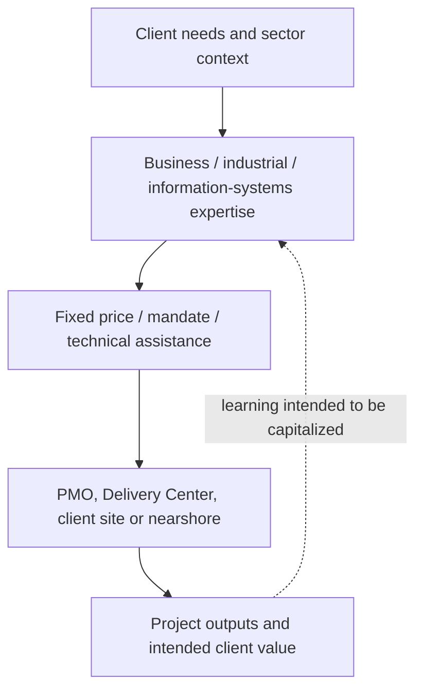

# Antaès Consulting — business-first two-pager (fixture proposal)

> **Review status:** proposed content for user validation; not yet added to the canonical regression fixture or manifest.  
> **Reuse rule:** treat the existing Antaès brief as a 20% starting corpus for the company and AI approach. Reuse only descriptive business signals; remove all candidate-fit, salary, hiring-decision, and personal-profile content. Recheck all retained claims against current sources.  
> **Evidence key:** **FACT** = directly supported; **COMPANY CLAIM** = statement or metric published by Antaès/T&S; **INFERENCE** = analytical interpretation; **UNKNOWN** = not established publicly.

## Page 1 — Description, position and strategic highlights

### Thesis

Antaès is a Swiss consulting and engineering business whose public proposition combines organizational performance, industrial expertise and information-systems delivery. Its business logic rests on mobilizing specialist consultants through several delivery modes, with PMO/Delivery Center capabilities and reusable team experience. The public material now describes a second growth loop around AI: use AI internally, strengthen consultant capability, and support customer transformations. The commercial scale of this AI loop is not yet disclosed. **FACT / COMPANY CLAIM; confidence: medium-high.**

### Signalétique

| Signal | Current public read |
|---|---|
| Identity | Founded in Geneva in 2007; Swiss management and technology consultancy. **FACT** [S1] |
| Scale | 320 consultants and 120 clients; the website also calls Antaès a Top 10 Swiss consultancy. The page gives no reporting date, employee definition, client-period basis or ranking methodology. Treat as company-published indicators, not audited headcount or market share. **COMPANY CLAIM** [S2] |
| Footprint | Company site lists Geneva/Petit-Lancy, Lausanne, Zurich and Singapore. It describes a Swiss and international client base. **FACT about published locations; customer/geographic mix UNKNOWN** [S1] |
| Service portfolio | Organizational performance/business management; industrial engineering; information-systems management, with Data/BI/AI and training also presented as offers. **FACT about published offer** [S1, S2] |
| Delivery model | Fixed-price work, mandate contracts and technical assistance; delivery at client premises, in Antaès offices or through nearshore capacity. The site describes a PMO and Delivery Center. **COMPANY DESCRIPTION** [S2] |
| Leadership | Antaès publishes a management committee including Jean-Jacques Berthin, Pierre Chatin, Anne Schwindenhammer and Pascal Vallet. The current public pages do not identify an Antaès CEO or CTO, or publish a board roster. T&S names Jérémie Huss as group CEO and Berthin/Chatin as Antaès directors. **FACT about published titles; governance perimeter UNKNOWN** [S3, S4] |
| Economics / ownership | Antaès revenue, margin, client concentration, project mix, utilization and recurring-revenue share are not disclosed in the reviewed sources. Antaès says it joined T&S in 2014; T&S describes a strategic partnership with Ardian since 2019. Current equity terms for Antaès/T&S are not established here. **UNKNOWN / FACT** [S3, S4] |
| Parent-group context | T&S currently publishes 3,500 experts, €320m revenue, 10 countries and 30 offices; the reporting period and consolidation basis are not stated on the page. These are group figures, not Antaès figures. **COMPANY CLAIM** [S4] |

### How the business creates and delivers value

**Published business mechanism:** combine business/sector expertise with engineering and information-systems delivery; choose a commercial mode suited to the engagement; coordinate execution through PMO/Delivery Center and customer/nearshore teams; reuse structured feedback from consultants. The final step is an explicit Antaès proposition, while the degree of reuse, margin contribution and repeatability are not quantified. **FACT about described operating model; economic effect UNKNOWN** [S1, S2].

**Optional structure diagram — source draft, not yet rendered by the current package**

The diagram describes Antaès’s stated delivery logic, not an independently measured causal model. Keep the feedback loop dotted until the reuse and economic contribution are evidenced. The two-pager renderer has no native Mermaid slot yet; retain this source separately or map it to a supported visual only after rendering is verified.

### Newsflow & strategic highlights — 24 months to 16 Nov 2026

- **18 Feb 2025 — Top 10 claim in Romandie.** Antaès says it appears among the ten largest IT firms in French-speaking Switzerland, attributing the ranking to ICTJournal. This is a positioning signal, not a measure of market share or profitability. **COMPANY CLAIM** [S5]
- **28 Aug 2025 — international registration-platform delivery.** Antaès describes a custom event-registration platform integrating online payment, CRM and website for an unnamed international client; the article reports 60 business users and 3,000+ registrations after one year. Client identity and independent validation are not supplied. **COMPANY-REPORTED DELIVERY EVIDENCE** [S6]
- **22 Dec 2025 — employee experience indicator.** Antaès reports a fourth consecutive HappyIndex®AtWork certification; the 2025 edition is said to show nearly 80% satisfaction and 9/10 employee recommendation. This is a workforce signal, not evidence of client economics. **COMPANY CLAIM** [S7]
- **23 Apr 2026 — luxury digital-platform case.** An unnamed luxury client; Antaès reports a seven-year workpackage, about 25 consultants, rollout across 30 languages and 50+ countries, test coverage moving from <50% to >80%, and 99.5% availability maintained for three years. Treat as the strongest public delivery proof in this sample, with the source’s client confidentiality and self-report caveat. **COMPANY-REPORTED DELIVERY EVIDENCE** [S8]
- **Sep 2026 — explicit AI operating thesis.** Antaès describes internal AI use for drafting, reporting, summaries and RFP work, and client support from use-case qualification through data analysis, experimentation, integration, change and governance. No adoption, productivity, revenue or margin results are published. The article page says 25 Sep while the news index says 15 Sep; date needs confirmation before final production. **COMPANY CLAIM / DATE CONFLICT** [S9, S10]
- **15 Oct 2026 — Microsoft Fabric thought leadership.** A Data Stack article signals practice communication; it does not establish a completed Fabric delivery or revenue. **POSITIONING SIGNAL** [S10]

### Evidence-based SWOT → conditional TOWS

| SWOT | Evidence and status |
|---|---|
| **S — Strengths** | Broad business + engineering + IS portfolio; several contracting/delivery modes; stated PMO/Delivery Center; 320-consultant/120-client company-published scale; two public delivery cases with concrete scope/outcomes. [S2, S6, S8] |
| **W — Weaknesses / constraints** | Public evidence omits revenue, margin, utilization, client concentration and service-line mix; AI outcomes and client references are not quantified. Broad portfolio may make differentiation harder to communicate. First two are **UNKNOWN**, last is **INFERENCE**. |
| **O — Opportunities** | Extend internal AI learning into repeatable client methods; connect Antaès AI offer with T&S group scale; use Geneva financial-services access and existing regulated-delivery work. **INFERENCE grounded in stated offer and footprint** [S4, S9, S11] |
| **T — Threats** | Consulting utilization/price pressure, competition from integrated groups and specialist firms, and data/IP/control risks in regulated AI delivery. **Sector-level hypotheses; no Antaès-specific quantified evidence in this fixture.** |
| **SO / ST / WO / WT paths** | **SO:** package AI discovery-to-integration where it can attach to proven delivery capabilities. **ST:** make data handling, human review and auditability explicit for regulated clients. **WO:** measure internal AI cases and publish a customer proof point before scaling the claim. **WT:** stage investment where value, delivery ownership and risk controls can be evidenced. These are conditional paths for testing, not recommendations. |

---

## Page 2 — Strategy, offer, execution and competitive position

### Strategy and execution

**Stated strategy:** Antaès frames AI as a dual loop: internal productivity and stronger consultant capability for customer transformation. Internal examples include drafting, reporting, synthesis and RFP processing; client work spans use-case qualification, data readiness, design/experimentation, process integration, change and governance. It favours existing controlled tools and corporate solutions for higher-confidentiality uses. **COMPANY CLAIM** [S9]

**Execution evidence:** The luxury-platform case demonstrates long-duration, cross-functional delivery, global scale, release/quality practices and reported technical KPIs. The AI publication describes an approach and intended practices, but does not identify deployed internal tools, owners, adoption, baseline, cost, measured gains, AI customer references or attributable revenue. Therefore: **delivery capability is evidenced in a non-AI case; AI execution and economics remain unproven publicly.** [S8, S9]

### Offers and use cases

| Offer / capability | Buyer problem and delivery | Evidence status |
|---|---|---|
| Business / organizational performance | Strategy, organization, change, program steering, compliance and risk management. | Offer published; revenue mix unknown. [S1] |
| Industrial engineering | Watchmaking, life sciences, mechanics, logistics and specialized machinery. | Offer published; project economics unknown. [S1] |
| Information systems / Data / BI / AI | Governance, business analysis, data reporting, architecture, implementation and integration. | Offer published; AI client outcomes not quantified. [S2, S9] |
| Geneva financial-services work | Regulatory projects, core-banking change, customer journeys, IT governance and ESG reporting. | Antaès lists sectors, profiles and examples; named clients and client-level outcomes are generally not disclosed. [S11] |
| Internal AI use | Drafting, reporting, synthesis and RFP processing. | Use cases named by Antaès; adoption and measured value unknown. [S9] |
| Customer AI transformation | Qualification, data, experimentation, integration, change and governance. | Service approach described; completed AI case evidence not identified in this source set. [S9] |

### Competitive insights and potential moat

**Relevant comparison set:** the company competes for transformation work with (1) integrated consulting/technology groups, (2) specialist business/engineering boutiques, and (3) technical-assistance / staff-augmentation providers. This is a market-structure lens, not a sourced competitor ranking. A named competitor benchmark would require a separate, normalized comparison by geography, service scope, contract model and proof of delivery.

**Differentiation hypothesis:** Antaès combines Swiss/local proximity, sector expertise, engineering and business/IS capabilities, multiple delivery modes, and a group platform. The public luxury case gives a concrete example of sustained delivery; the company also says its consultant experience is capitalized and reusable. **Potential moat mechanisms:** accumulated sector knowledge, trusted client access, delivery coordination, talent network and group breadth. **Durability is not demonstrated** without retention/repeat-work data, utilization and margin trends, proprietary methods/assets, client switching evidence or comparative win rates. [S1, S2, S4, S8]

### Executive takeaways

1. **The business is a consulting-and-delivery model, not an AI product vendor.** The offer spans business management, engineering and information systems, with fixed-price, mandate and technical-assistance modes.
2. **Its strongest public proof is delivery capacity.** The luxury platform case reports a seven-year, 25-consultant program at 30-language / 50+ country scale and technical outcomes; the client remains unnamed and the measures are company-reported.
3. **AI is a declared strategic extension with two intended value pools.** Internal productivity and client transformation are both stated, but adoption, ROI, revenue and margin evidence remain absent from the reviewed sources.
4. **The moat is plausible but not established.** Local access, reusable experience and T&S group capabilities could reinforce differentiation; persistence and economic advantage require customer and unit-economics evidence.
5. **The key business unknowns are measurable.** Revenue/service-line mix, repeat-client and project economics, AI baselines/results, pipeline conversion, and the operating contribution of the T&S group would materially change the assessment.

## Source register (reviewed 16 Nov 2026)

- **[S1] Antaès, “Pourquoi choisir Antaes ?”** Company history, three service areas, claimed reuse of consultant experience, footprint and contact locations. https://www.antaes.ch/choisir-antaes
- **[S2] Antaès homepage.** 320 consultants, 120 clients, Top 10 positioning, sectors, professions, delivery modes and PMO/Delivery Center description. https://www.antaes.ch/
- **[S3] Antaès legal notice.** Legal publisher and Jean-Jacques Berthin’s published title; not a full governance disclosure. https://www.antaes.ch/mentions-legales
- **[S4] T&S Group, “À propos de nous.”** Group scale, Ardian partnership context, multibrand model, leadership and Antaès directors. https://tands.com/fr/a-propos-de-nous
- **[S5] Antaès, “Antaes parmi les 10 plus grandes sociétés IT de Suisse Romande.”** Company article attributing the ranking to ICTJournal. https://www.antaes.ch/news/antaes-parmi-les-10-plus-grandes-societes-it-de-suisse-romande
- **[S6] Antaès, “Une plateforme d’inscription sur mesure.”** Company interview and reported customer/platform results. https://www.antaes.ch/news/une-plateforme-dinscription-sur-mesure-un-projet-qui-rend-fier-e-chez-antaes
- **[S7] Antaès, HappyIndex®AtWork 2025 article.** Company-reported employee indicators. https://www.antaes.ch/news/antaes-obtient-la-certification-happyindex-r-atwork-une-reconnaissance-de-son-engagement-humain
- **[S8] Antaès, luxury digital-platform business case.** Scope, delivery duration, team size and reported KPIs; client unnamed. https://www.antaes.ch/news/business-case-modernisation-et-scalabilite-dune-plateforme-digitale-dans-le-secteur-du-luxe
- **[S9] Antaès, “L’intelligence artificielle au service de la performance.”** Internal AI uses, intended consulting approach and governance claims. https://www.antaes.ch/news/lintelligence-artificielle-au-service-de-la-performance
- **[S10] Antaès news index.** Publication listing and date inconsistency for the AI article; Microsoft Fabric news date. https://www.antaes.ch/actualites
- **[S11] Antaès, Geneva city page.** Financial-services positioning, capability examples and described project types. https://www.antaes.ch/cities/geneve

## Fixture acceptance checks — pending user validation

- Two-page business description; no candidate profile, application decision, compensation, or employer-fit score.
- Prior brief used as a 20% seed; all retained company/AI claims rechecked against public sources.
- Revenue, Antaès employee count, client mix, board/CEO/CTO, AI ROI and moat durability remain explicitly unknown where not evidenced.
- Parent-group figures are separated from Antaès entity figures.
- Newsflow window is 16 Nov 2024–16 Nov 2026; article/listing date conflict is preserved.
- Company-reported project outcomes are labelled; client confidentiality and independent verification limits remain visible.
- SWOT-to-TOWS shows conditional paths and sector-risk hypotheses, not unsupported recommendations.
- Diagram source follows the business mechanism and is not treated as render-tested.
- Regression-fixture status remains pending; promote into the canonical fixture/manifest only after user acceptance and repository QA.
